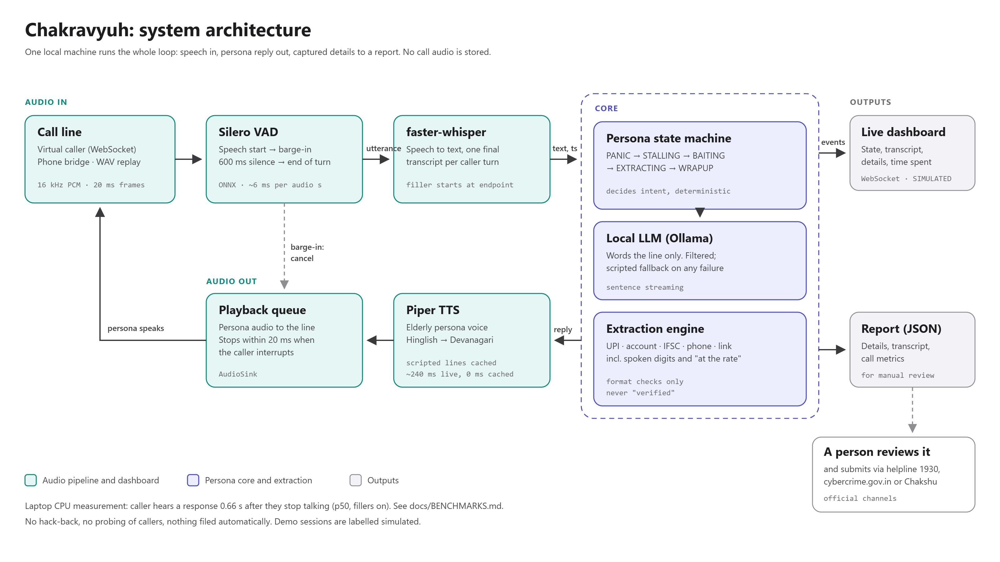
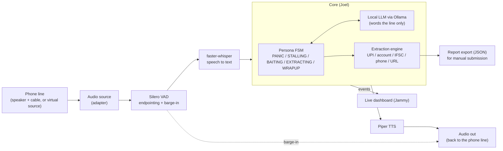
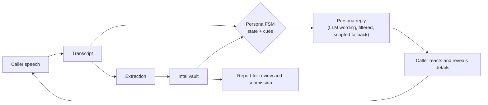

# Architecture

Exported diagrams for the submission (edit the SVG, then re-export the PNG at 2x):
[`diagrams/architecture.png`](diagrams/architecture.png) (system) and [`diagrams/data-loop.png`](diagrams/data-loop.png)
(AI framework / data loop). The Mermaid versions below are the editable sketches.

## System

## Data loop (what the judges' "AI framework" diagram shows)

The loop is closed by the caller: the FSM steers the conversation toward the point where a real payee identifier
has to be read aloud, then asks for repeats and spellings so the capture is accurate, then loops once more with a
believable failure to obtain a second identifier before handing the call to "my son".

## Components and owners

| Component | Owner | Notes |
|---|---|---|
| Persona FSM, LLM adapter | Joel | `fsm.py`, `llm.py` |
| Extraction, report export | Joel | `extract.py`, `report.py` |
| Corpus A | Joel | `corpus/` |
| Audio source, VAD, STT, TTS, barge-in | Jammy | `src/chakravyuh/audio/` |
| Dashboard and live feed | Jammy | `dashboard/` |
| Latency harness, corpus B | Jammy | `bench/`, `corpus/` |
| Contracts, guardrails | both | `contracts.py`, `docs/` |

## Key decisions
1. **FSM owns intent, LLM owns wording.** Behaviour is deterministic and testable; the model cannot decide to give
   out data or abandon the plan. Output is filtered (no long digit runs, no OTP talk, no links, no self-disclosure)
   and a scripted line is used on any failure or timeout.
2. **Local-first.** Whisper, Silero, Ollama and Piper run on the user's machine. Edge-TTS is an optional online
   fallback and is marked as such wherever it is enabled.
3. **Audio source abstraction.** The pipeline reads from an adapter (file replay, WebSocket virtual caller, phone
   cable), so development never waits on hardware.
4. **Synchronous core.** One worker thread calls `on_scammer_turn`. No shared mutable state with the dashboard;
   it only receives events.
5. **Format validation only.** Extraction never claims an identifier is verified or fraudulent.

## Latency budget (targets, to be measured by the harness)
| Stage | Target | Measured |
|---|---|---|
| End-of-speech detection (VAD endpointing) | <= 300 ms | TBD |
| Speech to text | <= 300 ms | TBD |
| First LLM token, 7B Q4 on the demo GPU | <= 400 ms | TBD |
| TTS time to first audio | <= 200 ms | TBD |
| **Turn gap, p50** | **< 1.2 s** | TBD |

A pre-cached filler ("haan ji...", "ek second...") plays while the LLM works. The number we quote in the pitch is
the measured one.

## Known ceilings (deliberate)
- Spoken UPI IDs where the local part itself is spelled in digit words are not reassembled.
- A bare "xyz at axl" can be mis-split when the speaker pauses mid-ID; the repeat-and-spell turn exists to catch this.
- The known-bank and known-UPI-handle lists are partial; unknown values are captured and flagged `valid: false`.
- LLM replies are not streamed yet; add sentence streaming if the harness shows first-token time dominates.
- Hindi is Roman-script Hinglish; if Piper's Hindi voice needs Devanagari, the audio layer transliterates.
